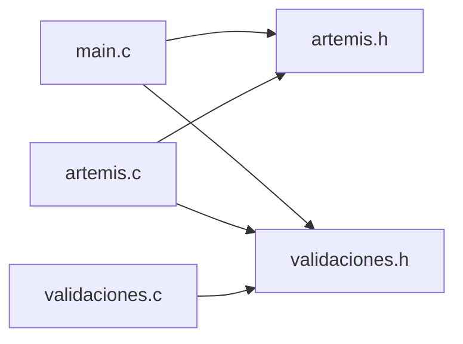

# Simulador Artemis: ascenso del SLS

Trabajo Práctico Integrador Final · Algoritmos y Estructuras de Datos · UTN FRRe

## Integrantes del grupo

- Altamirano, Mateo · Legajo 30048
- Hanke, Valentín Alfredo · Legajo 30638
- Lazcano, Francisco Agustín · Legajo 30725
- Mambrín, Joaquín · Legajo 30247
- Silva, Aixa Geraldine · Legajo 30192
- Vallarino, Daniel Eduardo · Legajo 30234

**Comisión:** K.1.1

## Enlaces

- Repositorio de GitHub: [repo](https://github.com/DonMIlaneso/Simulador-Artemis-SLS.git)
- Video demo: [video](https://drive.google.com/file/d/1x5IjRKBWWhWAy1icSeXFXUeeyAsWiA34/view?usp=sharing)


## Escenario asignado

**Situación - Problema 1: ascenso y propulsión con el SLS.** Es un simulador por consola, escrito en C, del despegue del cohete Space Launch System (SLS), que lleva a la nave Orion desde la plataforma del Centro Espacial Kennedy. El cohete sube en línea recta, y el programa lo modela con las ecuaciones del Movimiento Rectilíneo Uniformemente Variado (MRUV), aplicadas por tramos. No se considera la resistencia del aire.

Etapas del vuelo:

1. **Despegue:** el cohete parte del reposo (v₀ = 0, y₀ = 0) y acelera con a₁ = 20 m/s². Empujan el núcleo y los dos cohetes sólidos (SRB).
2. **Desacople:** a los t₁ = 120 s se sueltan los SRB, ya sin combustible.
3. **Segunda fase:** el núcleo sigue solo con a₂ = 12,5 m/s² hasta los h = 160 km. Ahí se apagan los motores (MECO).
4. **Vuelo balístico:** si los motores fallan en h, la nave sigue subiendo por inercia y la gravedad (g = 9,80 m/s²) la frena hasta que se detiene en su altura máxima.

### Qué responde el programa

| Pregunta | Cómo se calcula | Resultado con los datos del enunciado |
|---|---|---|
| a) Velocidad y altura al desacople | v₁ = a₁·t₁ · y₁ = ½·a₁·t₁² | 2400 m/s · 144 000 m |
| b) Rapidez máxima al apagar los motores | v₂ = √(v₁² + 2·a₂·(h − y₁)) | 2481,93 m/s |
| c) Altura máxima si los motores fallan en h | hmáx = h + v₂² / (2·g) | 474 285,71 m |
| d) Aceleración de la fase 1 en múltiplos de g | a₁ / g | 2,04 g |

Si el usuario carga valores con los que el cohete llega a h antes de t₁, el programa avisa que los motores se apagan con los SRB todavía acoplados y hace el cálculo para ese caso.

### Reglas del juego: Desafío del Director de Vuelo

- Se eligen entre 1 y 5 rondas.
- En cada ronda el programa sortea una misión distinta (a₁, t₁, a₂ y h) y el jugador calcula v₁, y₁, v₂, hmáx y a₁/g.
- Cada respuesta suma puntos según qué tan cerca quede del valor correcto:

| Error relativo | Puntos |
|---|---|
| hasta 1 % | 100 |
| hasta 5 % | 60 |
| hasta 10 % | 30 |
| más de 10 % | 0 |

- Antes de responder se pueden pedir las fórmulas, pero eso descuenta un 20 % de la ronda.
- Al final, el reporte de desempeño muestra el puntaje, el error promedio, la mejor ronda y una calificación. Las calificaciones, de mayor a menor rendimiento, son Director/a de Vuelo, Ingeniero/a de Guiado, Analista de Telemetría y Cadete.


## Funcionamiento

Al iniciar, el programa carga los valores del enunciado y muestra el menú principal:

| Opción | Qué hace |
|---|---|
| 1. Configurar parámetros | Cambia a₁, t₁, a₂, h y g dentro de rangos válidos, y avisa si la configuración no tiene sentido físico |
| 2. Análisis del ascenso | Resuelve a), b), c) y d) paso a paso: fórmula, reemplazo y resultado |
| 3. Simulación con telemetría | Muestra una tabla del vuelo cada Δt segundos con el perfil de altitud dibujado en ASCII. Marca el desacople, el MECO y el apogeo |
| 4. Desafío del Director de Vuelo | El juego por rondas descrito arriba |
| 5. Reporte de la sesión | Simulaciones realizadas, récords de altura y velocidad, e historial de partidas |
| 6. Reglas y ayuda | Explica el escenario y cómo ingresar los datos |
| 0. Salir | Pide confirmación y muestra el reporte final de la sesión |

### Organización del código

| Archivo | Contenido |
|---|---|
| `main.c` | Solo `main()`: inicializa el programa y muestra el menú |
| `artemis.h` | Constantes `#define`, estructuras (`typedef struct`) y prototipos |
| `artemis.c` | Cálculos físicos, simulación, desafío y reportes |
| `validaciones.h` / `validaciones.c` | Ingreso seguro de números y de respuestas S/N, y mensajes por pantalla |
| `Makefile` | Compilación automática |



Los datos se guardan en estructuras:

- `Parametros_Mision` tiene los valores de entrada.
- `Resultados_Mision` tiene las respuestas a)–d).
- `Telemetria` es un arreglo de hasta 1000 filas del vuelo.
- `Ronda_Desafio` guarda las respuestas de cada ronda.
- `Historial_Sesion` guarda hasta 20 partidas.

Las funciones reciben estas estructuras por puntero, y los máximos del vuelo y del historial se buscan recorriendo los arreglos con punteros.

### Validaciones

Cada dato se lee como una línea completa con `fgets()`, nunca con `scanf`, y antes de aceptarlo el programa revisa que sea un número válido y que esté dentro del rango permitido. Si hay un error, explica qué pasó y vuelve a preguntar, sin colgarse ni entrar en un bucle infinito.

| Dato | Rango aceptado |
|---|---|
| a₁ y a₂ | 0,1 a 60 m/s² |
| t₁ | 1 a 600 s |
| h | 1 000 a 2 000 000 m |
| g | 1 a 25 m/s² |

Además:

- Se aceptan coma o punto decimal (`12,5` o `12.5`).
- Se rechazan letras, líneas vacías, `inf`, `nan` y números demasiado grandes.


## Requisitos

- Compilador de C compatible con C99, por ejemplo GCC (en Windows, MinGW).
- Make, opcional, para compilar con el Makefile.
- Git, opcional, para clonar el repositorio.
- Funciona en Windows, Linux y macOS.

## Compilación y ejecución

**Opción 1: clonar y compilar con Make**

```bash
git clone URL-DEL-REPOSITORIO
cd NOMBRE-DE-LA-CARPETA
make
./artemis          # Linux o macOS
.\artemis.exe      # Windows
```

En Windows con MinGW, el comando `make` suele llamarse `mingw32-make`.

**Opción 2: compilar a mano con GCC**

```bash
gcc -Wall -Wextra -std=c99 main.c artemis.c validaciones.c -o artemis -lm
./artemis
```

En Windows se usa `-o artemis.exe` y se ejecuta con `.\artemis.exe`. El `-lm` enlaza la biblioteca matemática, que el programa usa para `sqrt` y `ceil`.

## Uso del programa

Un recorrido típico:

1. Abrir el programa. El menú ya muestra los valores del enunciado.
2. Elegir la opción **2** para ver las respuestas a)–d) desarrolladas.
3. Elegir la opción **3** para simular el vuelo:
   - indicar si los motores fallan en h;
   - elegir cada cuántos segundos (Δt) se muestra una fila de la tabla.
4. Elegir la opción **4** para jugar el desafío.
5. Elegir la opción **5** para ver el desempeño acumulado.
6. Para probar otros escenarios, cambiar los valores con la opción **1** o restaurar los del enunciado desde ese mismo submenú.

Al salir (opción **0**), el programa muestra el reporte final de la sesión.

La carpeta `web/` tiene una versión animada del simulador. Se abre con doble clic en `index.html`, sin instalar nada. Sirve como apoyo visual: el entregable es el programa de consola.


## Uso de Inteligencia Artificial

**Herramienta utilizada:** Claude (Anthropic).

**Tareas y consultas:**

- Generar una primera versión completa del programa en módulos, junto con el Makefile y el README, a partir del PDF del trabajo práctico. Consulta: *"Realiza el escenario 1 o problema 1"*.
- Reescribir el código de forma más simple, sin usar temas que todavía no se vieron en la materia, para poder explicarlo en el video. Consulta: *"Que no sea nada demasiado complejo [...] con los conocimientos de la cátedra"*.
- Crear la página web con el simulador animado y después reducirla al título, una breve introducción y el simulador.
- Redactar este README de forma más sencilla, tomando como modelo de formato el README de otro grupo del mismo escenario.

**Cómo se validó y adaptó:**

- La primera versión usaba `enum`, funciones `static` y el operador `?:`. Se reemplazaron por constantes `#define` y condicionales comunes, para que el código quedara dentro de lo visto en la cátedra.
- Se compiló con `gcc -Wall -Wextra -pedantic -std=c99` sin advertencias.
- Las respuestas a)–d) del programa se compararon con el cálculo hecho a mano.
- Se probaron entradas inválidas: letras, línea vacía, valores fuera de rango, `inf`, `1e999`, líneas de más de 127 caracteres y cierre de la entrada con Ctrl+D.
- Se jugó una partida completa del desafío y se comprobó el puntaje de cada ronda.
- Se ejecutó con AddressSanitizer, que no detectó errores de memoria.
- Se detectó y corrigió un error en la condición del caso especial: decía ≥ cuando el código usa >.
- Los valores de la página web se compararon con los del programa en C.
